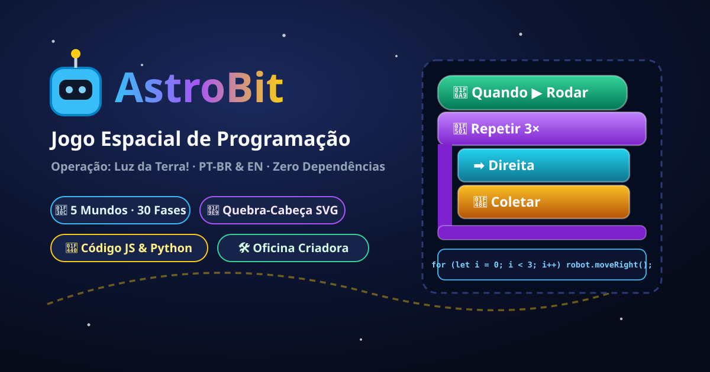

# 🚀 AstroBit

[](LICENSE)
[](#architecture)
[](#local-development--tests)
[](https://lucasvalequeiroz.github.io/astrobit/)

An open-source **educational space coding puzzle game** built to teach young learners (ages 5–10+) computational thinking — from visual **interlocking SVG jigsaw blocks** all the way to **loops**, **conditional sensors**, **reusable functions (`F1`/`F2`)**, **"Bug Hunt!" debugging**, and live **JavaScript / Python** code previews.

> Built with **zero runtime dependencies** (native ES Modules + HTML5 Canvas 2D + Web Audio API + `node --test`) so it loads instantly on any computer, tablet, or phone directly from GitHub Pages.



---

## ✨ Key Features

- **📖 Story Campaign — *"Operação: Luz da Terra!"* (PT-BR & EN):**
  - 3-scene animated **Intro Cinematic**, per-world **Planet Arrival Briefings**, custom story hooks and triumph lines for all **30 bases**, and a **Grand Finale Ending Cinematic** with an Official Space Engineer Medal!
- **🗺️ Animated Galaxy & Planet Journey Map:**
  - Fly **Starship Estrela-1** across 5 planets and 30 planetary bases along glowing curved star trails (`🌍 Earth` → 5 Worlds → `☀️ Solar Beacon`).
- **🧩 Physical SVG Interlocking Jigsaw Puzzle Editor (1-Screen Desktop UX):**
  - Tactile 4-direction **Compass Palette** (`⬆️ ⬇️ ⬅️ ➡️`), true male/female SVG jigsaw connectors, C-shaped `🔁 Repeat` and `🔎 If (sensor)` clamps, reusable `⚡ F1` / `🌟 F2` stacks, drag-and-drop reordering, live dotted path preview, and keyboard shortcuts (`Space`, `S`, `R`, `Ctrl+Z`).
- **🌌 5 Progressive Worlds · 30 Mathematically Proven Levels (⭐ 90 Stars):**
  1. 🌙 **Moon of Crystals** — Sequences & 4-direction planning
  2. ⚙️ **Gear Planet** — Loops (`Repeat N×`) & nested loops
  3. ⚡ **Laser Belt** — Switches, retractable bridges, paired portals & conditional sensors (`If`)
  4. 🛰️ **Function Station** — Decomposition & reusable subroutines (`F1`, `F2`)
  5. 🌌 **Engineer Nebula** — 3 interactive **"🐛 Bug Hunt!"** debugging puzzles & Grand Finale
- **👀 Visual Step-by-Step Debugger & Live JS / Python Code Peek:**
  - Step one piece at a time (`⏭️`), see the exact piece causing a bump, and watch your puzzle transpile line-by-line into real **JavaScript** or **Python**.
- **🛠️ Creative Level Workshop (`?custom=...`):**
  - Paint custom space puzzles (floor, rocks, void, robot, crystals, goal, switches, lasers, bridges, portals), test immediately, save a local family library, and share playable links via compact URL-safe Base64 — **zero backend required**!
- **🎨 Robot Garage:**
  - Unlock 6 animated robot skins (from *Explorador Azul* to *Engenheiro Estelar* with crown at `45★`) with a live star progress bar.

---

## 🧪 Local Development & Tests

Requires only **Node.js 20+** (zero `npm install` needed):

```bash
git clone https://github.com/LucasValeQueiroz/astrobit.git
cd astrobit

# Run all 27 engine, interpreter, transpiler, story, workshop, and 30-level solvability tests
node --test tests/*.test.mjs

# Preview locally
python -m http.server 8080
```

---

## 🏗️ Architecture

```text
assets/
└── og-preview.svg     # 1200×630 vector OpenGraph social preview
src/
├── engine/            # Pure DOM-free grid, AST interpreter, JS/Python transpiler, validator & custom-level codec
├── levels/            # 5-world / 30-level campaign with mathematically verified 3★ reference solutions
├── story/             # Bilingual narrative bible ("Operação: Luz da Terra!") & scenic flight coordinates
├── renderer/          # 60fps HTML5 Canvas 2D space renderer, expressive robot skins & particle effects
├── audio/             # Zero-asset Web Audio API synthesizer (snaps, crystals, portals, rocket launch, fanfare)
├── ui/                # SVG jigsaw workspace, animated galaxy/ship map, creative workshop, garage & PT/EN i18n
└── storage/           # Local progress, stars, story state, skins & custom level library (localStorage)
```

---

## 📄 License

Released under the [MIT License](LICENSE).
